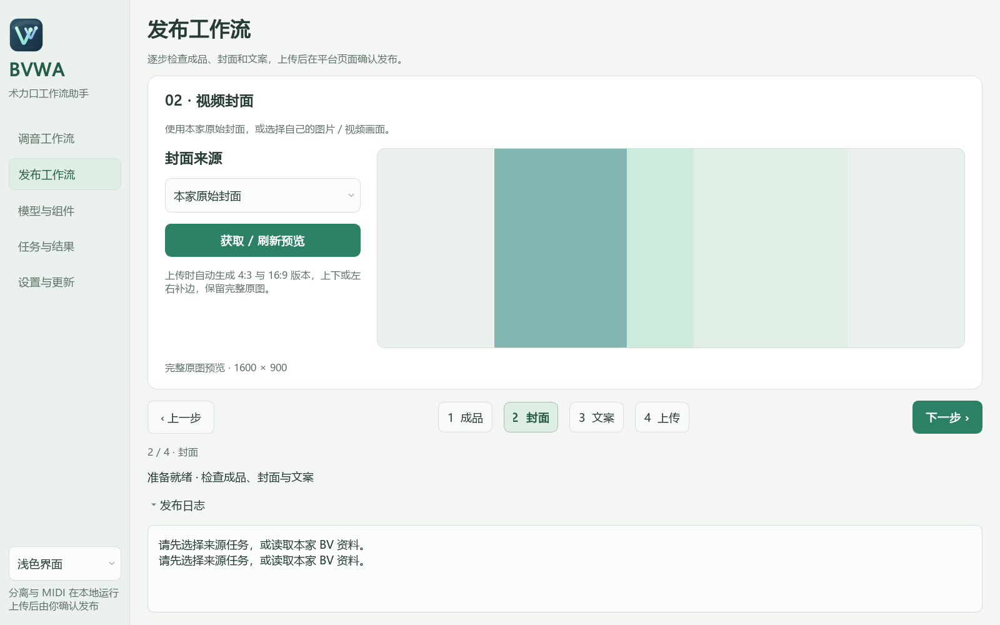

<p align="center"></p>

# 术力口工作流助手

Better Vocaloid Workflow Assistant (BVWA)

[English](README.md) | [简体中文](README.zh-CN.md)

面向 Windows 的声库调音工作流助手。从本地音乐或 B站视频开始，分离人声与伴奏，生成带歌词的 MIDI；调音完成后，准备成品视频的封面、简介和平台上传。


## 功能

- 可展开的工作流卡片、处理预设与各引擎 CPU / GPU 设备设置。
- 任务搜索、筛选、排序和管理，分阶段进度、错误恢复与缓存清理。
- 网易云时间轴或 MIDI 歌词事件匹配字幕，支持声部选择与逐行校准。

- 支持 B站 BV 号／链接和本地音频。
- 分离人声与伴奏，分别生成主唱和和声 MIDI。
- 内置 Karaoke 2，可按需安装支持 CPU／NVIDIA GPU 的 BS-RoFormer。
- 支持中文和日语歌词；中文 MIDI 可选择汉字或拼音。
- 支持任务续跑、参考歌词和完整 WAV 分轨导入。
- 获取原视频封面，编辑来源署名，准备 B站和小红书上传。
- 提供无控制台窗口的 EXE 启动器及经过校验的程序更新。

调音、最终音视频对齐和最终发布由用户完成。使用结果前，请试听分离音频并核对音符与歌词。

## 快速开始

1. 从 [Releases](https://github.com/Transilent/Better-Vocaloid-Workflow-Assistant/releases) 下载完整便携包。GitHub 自动生成的 **Source code** 是源码，不包含完整运行库。
2. 将全部分卷和 `release-assets.json` 放在同一目录。用 7-Zip 打开 `.001`，或通过 `Merge-PortableParts.ps1` 校验并合并。
3. 解压完整 `BVWA` 文件夹到可写目录，例如 `D:\BVWA`。
4. 双击 **`BVWA.exe`**。
5. 在“调音工作流”中选择工作流预设、添加音乐，点击“开始处理”。

## 升级

v0.3.0、v0.3.1 支持在线升级到 v0.4.0。在**设置与更新**中检查更新、下载并重启安装；第一次重启会打开升级窗口，仅下载新增依赖和适配代码，复用已安装模型，完成后自动重启进入 v0.4.0。支持 GitHub 直连、GitProxy 加速、校验续传和失败回滚。设置、任务、平台登录会话和可选模型会保留。后续更新会选择与当前运行库相匹配的程序更新包。

首次安装请下载完整便携包。升级前请备份正在编辑的工程。GitHub 的 Source code 和单独的更新 ZIP 均不能作为完整安装包使用。

## 保存目录

在“音频导出 → 保存目录”点击“选择目录”，或输入新的文件夹路径。保存目录用于整个任务，关闭音频导出时也生效。默认使用助手目录的 `jobs` 文件夹。每个任务会新建独立子文件夹，保存下载的视频（BV 输入为 `video/source.mp4`）、音频和 MIDI。助手会记住所选目录及以前的任务位置；继续任务沿用原目录，重新处理则在当前选定目录中新建任务。

## 歌词与输出

新任务默认使用 Vocal2Midi 2.0，无需选择提取后端。旧任务继续使用其记录的处理设置。

选择中文后，“中文歌词格式”提供“汉字”和“拼音”。此设置同时用于主唱与和声，并随任务保存。关闭“识别歌词并写入 MIDI”时只导出音符。中文格式选项不影响日语识别。

参考歌词可选填，主唱与和声分别填写，只保留演唱文本。完成后在“任务与结果”查看文件。

| 文件 | 内容 |
| --- | --- |
| `midi/voices.mid` | 时间对齐的主唱、和声双轨 MIDI |
| `midi/lead/lead.mid`、`midi/backing/backing.mid` | 单独声部 MIDI |
| `midi/vocals.mid` | 合并人声模式的结果 |
| `audio/lead.wav`、`audio/backing.wav` | 主唱、和声分离音频 |
| `audio/instrumental.wav` | 伴奏 |

VOCALOID 6 请通过“文件 → 导入”载入 MIDI，提供歌词编码选项时选择 UTF-8。MIDI 使用 120 BPM 换算时间，不代表自动检测了歌曲速度。

## 可选模型与下载源

在“模型与组件”选择运行库和下载方式，点击“下载并安装”；安装完成后选择“使用此模型”。

| 运行库 | 下载量 | 安装后约占用 |
| --- | --- | --- |
| CPU | 0.46 GB | 1.56 GB |
| NVIDIA GPU / CUDA | 3.52 GB | 6.14 GB |

安装支持取消、续传和 SHA-256 校验。中日文使用同一份原始 BS-RoFormer 权重；日语识别保留现有 Romaji ASR。

“中文歌词识别 → 校验 / 恢复中文模型”会检查原始 Qwen 权重，只下载缺失或损坏的文件。完整运行库包含这部分模型，约占 4.38 GiB；日语识别和纯音符提取可独立运行。清理缓存时请保留模型文件。

下载方式包括“自动选择”“官方源直连”和“优先加速源”。自动模式在连接失败后尝试备用源。GitHub 文件支持 [GitProxy](https://gitproxy.dev/guide)，Hugging Face 模型支持 [HF-Mirror](https://hf-mirror.com/)；其他运行库依赖从官方源下载。下载速度和可用性取决于网络与所选服务。

## 工作流、任务与恢复

**调音工作流**包含六个可展开的步骤：音乐来源、分离声部、参考歌词与校准、MIDI 与工程、音频导出、歌词转字幕。展开后使用完整内容宽度，文字、输入框和点击区域均已增大。顶部的**设备设置**集中选择各引擎的处理设备。预设保存语言、模型、设备与导出格式，不包含歌曲路径或参考歌词。

侧栏依次是调音工作流、发布工作流、模型与组件、任务与结果、设置与更新，底部可切换浅色与深色界面。浅色界面使用淡绿灰背景、白色卡片和绿色强调色；深色界面使用实色深灰绿面板。窗口保留系统标题栏和常规操作。

“设备设置”还提供共用的“DirectML 显卡”和“CPU 线程数”。自动模式优先选择独立显卡，并保留各引擎的默认线程设置。指定线程数会限制相关 CPU 运算的线程数量；线程更多不一定更快。这些选项随预设保存。

取消 MIDI 与工程即可只处理音频；编辑器工程也可单独关闭，仍保留标准 MIDI。工程支持 USTX、VSQX、SVP，可保留 RMVPE 音高线并引用伴奏。音频支持 WAV、FLAC、MP3、OGG，WAV 直接使用任务音频。合成歌声需要在编辑器中渲染。

分轨峰值超出音频范围时，FLAC、MP3、OGG 会共享必要的峰值衰减，保持人声与伴奏之间的音量关系。增益记录在 `exports/report.json` 中，原始浮点 WAV 保留完整信号。

**任务与结果**支持搜索、筛选、重命名、查看日志和重试。继续任务使用其记录的参数；**用当前工作流重做**使用当前预设创建新任务。进度显示已完成阶段、耗时和可测量的子任务。复用结果前会校验文件，设备错误可改用 CPU 继续。

## 缓存管理与歌词字幕

导出文件与记录的内容不同时，重新生成前会将原文件保存到任务的 `backups/` 文件夹，并在报告中记录位置。直接修改 MIDI 或工程后也能保留编辑内容；未修改的正常结果不会额外备份。建议把正在调音的工程另存为工作文件。

在**设置与更新 → 缓存与磁盘**中扫描占用，选择可再生成的缓存后清理。任务结果、模型、预设和登录信息会保留。下载及未完成的分段缓存可在相关操作结束后清理。

WAV 导出直接使用任务中已有的音频，压缩格式另行保存。继续任务时会校验输入与输出；损坏的导出文件逐个修复。发布资料保留成品视频的路径与哈希，不重复复制完整视频。上传前请保留成品文件，移动或修改后重新生成发布资料。

**参考歌词与校准**卡片位于分离声部之后。选择**网易云匹配**，可搜索歌名和歌手或粘贴歌曲 ID／链接，选中的原文歌词默认填入主唱；选择**本地匹配**，可导入 LRC／YRC／TXT 歌词或直接填写，留空时从对应人声音频本地识别。两个来源分别保留主唱文本，网易云匹配不会覆盖和声歌词。参考文本会与人声音频对齐，歌曲时间戳不会直接移动 MIDI 音符。

**歌词转字幕**卡片分为**网易云匹配**与 **MIDI 匹配**：前者使用歌曲已有的歌词时间轴，后者使用 MIDI 歌词事件与速度变化。导入多轨 MIDI 后可选择声部，两个来源各自保留编辑内容。核对文字、时间和整体偏移后导出 UTF-8 SRT／WebVTT。没有时间轴的纯文本不能直接生成字幕，不会按总时长均分。字幕匹配不覆盖音乐提取使用的参考歌词。

## 程序更新

“设置与更新”提供版本检查、变更说明和默认下载方式。默认仅在启动时自动检查、下载并安装更新。启动更新校验完成后，显示 10 秒倒计时，重启安装并重新打开助手；可选择“暂缓安装”继续使用当前版本。开始使用助手后，自动安装延至下一次启动。使用过程中不会定时检查更新；手动下载的更新需要点击“重启并安装更新”。

程序更新下载较小的更新包，保留配置、任务、平台登录及已安装模型。文件替换失败会恢复原程序。涉及基础运行库变化的版本，需要下载完整便携包。

`release-assets.json` 提供版本信息与校验值。v0.3.0 已提供程序更新包，适用于基础运行库相同的安装目录；v0.2.0 需下载完整版。

## 发布工作流

**发布工作流**位于调音工作流下方，每次显示一个完整步骤：

1. **成品与来源**：选择成品视频和来源任务，或通过 BV 读取本家资料。
2. **视频封面**：大图预览本家原始封面，也可选择图片或视频画面。本地音乐任务需要自选图片，或另行读取 BV 来源。
3. **标题与简介**：同时编辑两平台文案，应用标题格式与署名，并核对字数和 STAFF。
4. **账号与上传**：点击“生成发布资料”，登录后点击“上传所选平台”。主按钮固定在底部，滚动内容时仍可操作。

底部的上一步、下一步和步骤编号用于切换页面；点击下一步时会检查当前必填内容。各平台分别提供登录、继续填写和关闭任务入口，不可用的操作会禁用。登录完成后关闭登录窗口；上传后保留创作页面，由用户检查并手动发布。

本家封面从视频资料读取，截图与自选图片是独立选项。适配 4:3 和 16:9 比例时按需补边，保留完整原图。

修改成品、封面或文案后，需要重新生成发布资料。“继续填写当前上传”可更新仍打开且视频相同的上传页面。浏览器关闭后需重新上传。发布前请在创作页面核对分区、标签、署名和其他必填项。



## 环境与故障排查

B站简介、引用来源、原封面和媒体下载使用直连，不继承系统代理或代理环境变量。组件下载和更新检查直接连接所选的官方源或加速源；运行库安装及助手的专用登录与上传浏览器也使用直连。读取失败时，请检查当前网络是否能访问来源，再重试或切换下载源。

- Windows 10／11 x64，建议 16 GB 内存。
- 下载、合并和解压建议预留约 25 GB；可选组件与素材需要额外空间。
- 保留程序旁的 `dependencies`、`models`、`assets` 和 `components`。迁移时复制完整目录。
- 启动错误见 `launcher.log`；诊断工具位于 `tools/`。
- 在新电脑使用时，需重新登录发布平台。

| 诊断工具 | 用途 |
| --- | --- |
| `tools/Start-Diagnostics.bat` | 显示启动诊断信息，并安装缺失运行库 |
| `tools/Check-Dependencies.bat` | 校验内置运行库 |
| `tools/Use-CPU.bat`、`tools/Use-GPU.bat` | 切换基础流程的 CPU／DirectML 设置 |

## 开发

应用源码位于 `src/`，配置模板与构建清单位于 `packaging/`；测试、工具和文档各自存放在对应目录。模型及大型运行库单独分发。

从源码启动时，`tools/Start-Diagnostics.bat` 会准备开发运行目录并安装缺失运行库。请修改 `src/` 中的代码，并在测试或构建前执行下面的准备命令。该命令只复制开发文件，不修改用户设置或项目数据。

```powershell
powershell -NoProfile -ExecutionPolicy Bypass -File .\tools\Prepare-Source.ps1
& '.\dependencies\vocal2midi\python\python.exe' -B .\tools\build_windows_launcher.py
& '.\dependencies\vocal2midi\python\python.exe' -B .\tests\run_tests.py
& '.\dependencies\vocal2midi\python\python.exe' -B .\pipeline.py --audio-file 'D:\Music\song.wav' --zh-lyric-mode pinyin
```

`cache/`、`jobs/` 和 `publish-packages/` 中的用户数据不进入干净发行包和 Git。详见[贡献说明](CONTRIBUTING.md)、[更新记录](CHANGELOG.md)、[使用指南](docs/UserGuide.zh-CN.md)和[结构说明](docs/Architecture.zh-CN.md)。正式打包前需通过自动检查和用户测试确认。

## 许可证

助手原创代码采用 [MIT 许可证](LICENSE)。随附运行库与模型各自保留原有许可证，详见[第三方声明](THIRD_PARTY_NOTICES.zh-CN.md)。

组件与更新的大文件下载在服务端支持 HTTP Range 时使用最多 8 个并发连接，可续传并校验 SHA-256；不支持的服务端使用单连接。上传 GitHub 直接使用官方端点。

## 相关项目与致谢


助手集成了已有工具和模型流程，感谢各项目的作者与贡献者。

| 项目 | 在助手中的用途 |
| --- | --- |
| [LibreSVIP](https://github.com/SoulMelody/LibreSVIP) | USTX、VSQX、SVP 工程转换；MIT |
| [163MusicLyrics](https://github.com/jitwxs/163MusicLyrics) | 歌词查询行为参考，未附带其桌面程序 |
| [Vocal2Midi](https://github.com/Xiantaidu/Vocal2Midi) | 通过内置应用层提取音符、对齐歌词并输出 MIDI；仓库许可为 Apache-2.0 |
| [Ultimate Vocal Remover](https://github.com/Anjok07/ultimatevocalremovergui) 与 [UVR 模型仓库](https://github.com/TRvlvr/model_repo) | MDX 推理参考、分离权重及参数；无需运行 UVR 桌面软件 |
| [Pymss](https://github.com/pymss-project/pymss) / [Pymss Studio](https://github.com/pymss-project/pymss-studio) | 可选 BS-RoFormer 推理；Studio 的侧栏、卡片与操作分组作为界面设计参考 |
| [becruily/bs-roformer-karaoke](https://huggingface.co/becruily/bs-roformer-karaoke) | 可选原始权重与配套配置 |
| [PyTorch](https://pytorch.org/) | 可选组件的 CPU / CUDA 推理运行库 |
| [yt-dlp](https://github.com/yt-dlp/yt-dlp) | B站媒体下载 |
| [FFmpeg](https://ffmpeg.org/) / [Jellyfin FFmpeg](https://github.com/jellyfin/jellyfin-ffmpeg) | 音频解码、媒体检测、视频截图 |
| [Playwright for Python](https://github.com/microsoft/playwright-python) | 浏览器登录及创作页面操作 |
| [ONNX Runtime](https://github.com/microsoft/onnxruntime) | CPU / DirectML 推理 |
| [PyQt](https://www.riverbankcomputing.com/software/pyqt/) | 桌面界面 |
| [NumPy](https://numpy.org/)、[SciPy](https://scipy.org/)、[librosa](https://librosa.org/)、[SoundFile](https://github.com/bastibe/python-soundfile)、[Mido](https://github.com/mido/mido)、[Pillow](https://python-pillow.org/) | 音频、数值、MIDI 和图像处理 |

Vocal2Midi 流程还使用 [GAME](https://github.com/openvpi/GAME)、[HubertFA](https://github.com/wolfgitpr/HubertFA)、[LyricFA](https://github.com/wolfgitpr/LyricFA)、[llama.cpp](https://github.com/ggml-org/llama.cpp) 及其语音、音高模型。详细致谢保留于[上游说明](dependencies/vocal2midi/ACKNOWLEDGEMENTS.md)，组件授权见[第三方说明](THIRD_PARTY_NOTICES.zh-CN.md)。各项目与模型保留独立许可证，此列表不表示整个包采用同一授权。
