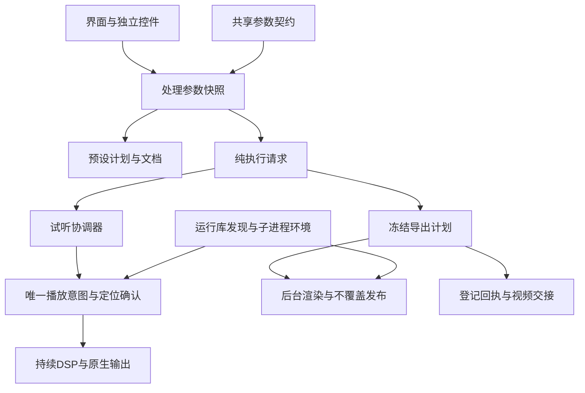

# 简易混音架构

简易混音从可编辑界面状态生成一份处理参数快照；预设保存、差异预览、连续试听和离线导出使用相同投影规则。控件不承担音频处理，后台执行不回读界面控件。

| 模块 | 负责 | 边界 |
|---|---|---|
| `quick_ui/MixdownPage.qml`、`MixdownEq.qml`、`MixdownMeter.qml` | 轨道、推子、曲线、实时测量与播放控件 | 展示控制器状态并发送编辑命令 |
| `quick_mixdown` / `mixdown_workspace_state` | 输入身份、参数、预设、工作区状态、任务登记与视频交接 | 同一份工作区状态；后台任务只接收已捕获的输入 |
| `mixdown_contract` | EQ范围及有效值、轨数、混响标识和GR数值契约 | 无Qt/文件访问；界面、预设和执行层复用 |
| `mixdown_request` | 纯处理快照、A/B旁通投影、完整执行请求 | 无文件探测；不另存一套可变工程状态；传入实际采样率 |
| `mixdown_preset_documents` / `preset_library` | 文档应用计划、范围与差异预览 | 应用前核验当前参数和预设身份；导入默认附加 |
| `mixdown_preview_controller` | 当前输入身份、待提交编辑、请求的A/B与本地定位手势 | 不拥有第二份播放意图、媒体时钟或时长，不读取Qt/文件 |
| `quick_mixdown_player` / `mixdown_realtime_core` | 唯一播放意图、会话代次、确认位置、命令合并与确认 | Qt 适配只处理计时和信号；核心及服务不依赖 GUI |
| `mixdown_realtime_service` / `mixdown_transport` | 子进程生命周期及协议 | 同代命令/回执；旧代结果不得确认新定位 |
| `mixdown_realtime_session` / renderer / graph / native | DSP、持续PCM及原生WASAPI输出 | 实时链单一；不生成分段试听WAV，不恢复旧播放器 |
| `mixdown_deesser` | 逐轨短促齿擦音检测、增益包络与削减读数 | 实时与离线共享 Pedalboard 滤波和 NumPy 包络，位于推子、共享人声效果和混响发送之前 |
| `mixdown_export` / `mixdown_loudness` | 隔离后台渲染、成品测量、选段响度匹配、发布与清理 | 导出及匹配各自冻结输入。导出绑定 WAV 摘要，匹配只改变现有播放器的限幅后监听增益 |
| `mixdown_runtime` | 固定运行库/组件发现、子进程环境、取消及文件辅助 | 连续试听与导出复用；组件缓存只有一份 |

用户拖动期间，本地手势拥有显示光标；释放或键盘合并提交后，只有播放器确认最新定位，光标才恢复跟随真实媒体位置。暂停/继续统一改变播放器的播放意图，因此等待参数或定位时，旧快照不会把暂停操作改回播放。源替换、设备故障和实际关闭分别处理；切页或最小化保留会话。

常用桌面布局为左侧混音台、右侧较宽的曲线与分析区。放大曲线时暂时隐藏轨道与导出区，恢复后保留设置。播放进度条固定在编辑滚动区之外。

EQ 校验在 `mixdown_contract`，曲线响应共用 `mixdown_eq_math`。试听循环范围通过独立 transport 控制，导出保持整曲。

## 人声修整与导出检查

- 在歌声轨的文件和设置按钮下方点击「去齿音」，用同一区域的滑块调强度，新轨初始设为关闭。开启时的初始强度为 45%，对应高频支路最高 2.7 dB 的削减。播放处理后声音时，滑块旁显示实际削减。耳机按钮可临时监听这路被移掉的声音，再次点击或切换 A/B 可返回混音。
- 在播放区设置试听范围后点「同响度 A/B」。后台按两侧共同拥有的媒体时间测量，播放期间可以照常切换。匹配会在监听端降低较响的一侧。源文件、混音设置或选段改变后可以重新匹配。短于 0.4 秒或低于计量门限时有相应提示。
- 导出后在底部查看整曲响度 LUFS、真峰值 dBTP 和采样峰值 dBFS。若限幅前超过 0 dBFS，按钮可跳到首次超载，悬停可查看其他已记录位置。指标来自成品扫描，录入任务时同成品摘要一起写入回执。测量失败会显示原因，已通过检查的 WAV 仍可交付。

回归重点是完整用户路径：三路歌声与伴奏、路由/增益/偏移、预设应用和撤销、A/B、播放/暂停、定位、循环、曲尾、后台保活、实际导出、源文件不变与任务交接。当前延迟按用户反馈作为回归观察，不将旧50ms专项目标重新写成已经达标。静音设备验证与真人听感、多声卡/热拔插验收分别记录。
