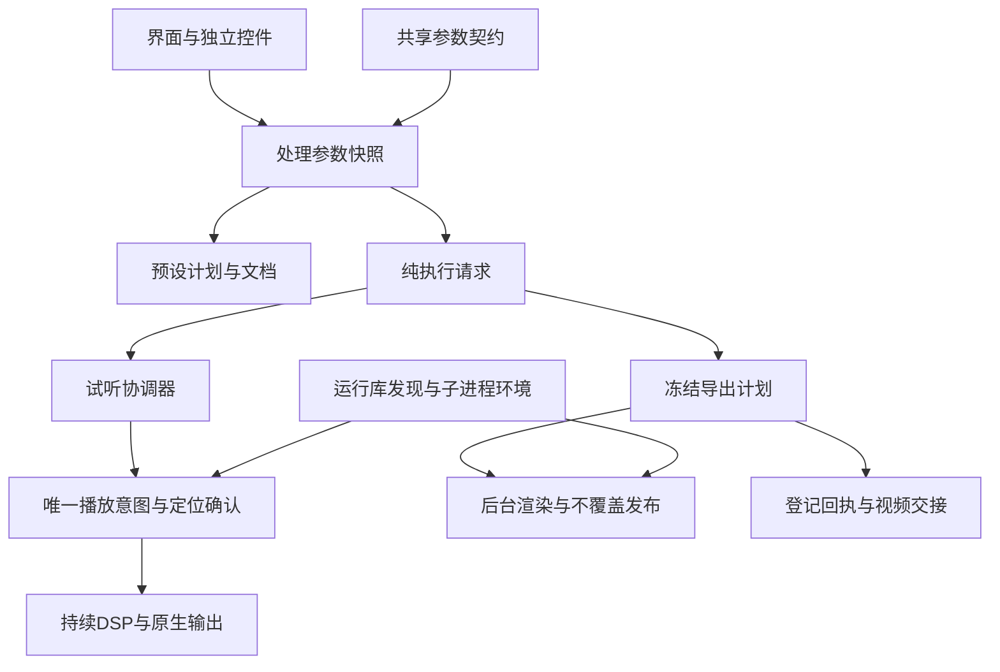

# 简易混音架构

简易混音从可编辑界面状态生成一份处理参数快照；预设保存、差异预览、连续试听和离线导出使用相同投影规则。控件不承担音频处理，后台执行不回读界面控件。

| 模块 | 负责 | 边界 |
|---|---|---|
| `audio_mixdown_ui` | 布局、读取控件、显示状态和测量、预设交互、任务登记与视频交接 | UI线程读取参数；后台任务只接收已捕获的输入 |
| `mixdown_widgets` | 推子、声像、进度条、表头、响应式机架与布局控件 | 单份Qt实现；不依赖主界面、音频服务或可变混音DTO |
| `mixdown_contract` | EQ范围及有效值、轨数、混响标识和GR数值契约 | 无Qt/文件访问；界面、预设和执行层复用 |
| `mixdown_request` | 纯处理快照、A/B旁通投影、完整执行请求 | 无文件探测；不另存一套可变工程状态；传入实际采样率 |
| `mixdown_preset_documents` / `mixdown_preset_ui` | 文档应用计划、范围与差异预览 | 应用后经UI回读，变更预览身份失效；导入默认附加 |
| `mixdown_preview_controller` | 当前输入身份、待提交编辑、请求的A/B与本地定位手势 | 不拥有第二份播放意图、媒体时钟或时长，不读取Qt/文件 |
| `mixdown_realtime_player` | 唯一播放意图、会话generation、确认位置、命令合并与确认 | GUI通过公开接口读取；服务线程运行，不在音频回调中执行Python |
| `mixdown_realtime_service` / `mixdown_transport` | 子进程生命周期及协议 | 同代命令/回执；旧代结果不得确认新定位 |
| `mixdown_realtime_session` / renderer / graph / native | DSP、持续PCM及原生WASAPI输出 | 实时链单一；不生成分段试听WAV，不恢复旧播放器 |
| `mixdown_export` | 捕获导出计划、后台渲染、源身份验证、发布新文件、失败清理 | 无Qt；请求、源快照和最终回执参数冻结，worker不读取控件 |
| `mixdown_runtime` | 固定运行库/组件发现、子进程环境、取消及文件辅助 | 连续试听与导出复用；组件缓存只有一份 |

用户拖动期间，本地手势拥有显示光标；释放或键盘合并提交后，只有播放器确认最新定位，光标才恢复跟随真实媒体位置。暂停/继续统一改变播放器的播放意图，因此等待参数或定位时，旧快照不会把暂停操作改回播放。源替换、设备故障和实际关闭分别处理；切页或最小化保留会话。

`MixState`、`TrackState`、`mixdown_presets.apply_preset`及仅被旧测试使用的另一套推子映射已移除，`mixer_state.py`不再打包。实际推子taper在`mixdown_widgets`，EQ校验在`mixdown_contract`。请求不再携带分段试听的preview切片字段；实时循环区间通过独立transport控制，导出保持整曲。

回归重点是完整用户路径：三路歌声与伴奏、路由/增益/偏移、预设应用和撤销、A/B、播放/暂停、定位、循环、曲尾、后台保活、实际导出、源文件不变与任务交接。当前延迟按用户反馈作为回归观察，不将旧50ms专项目标重新写成已经达标。静音设备验证与真人听感、多声卡/热拔插验收分别记录。
